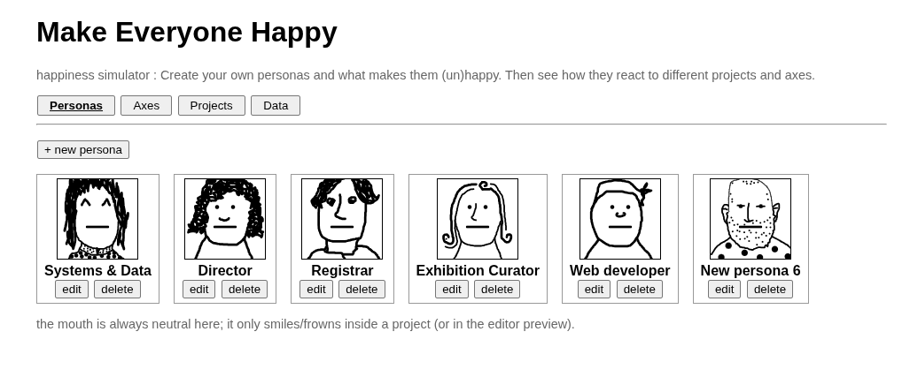
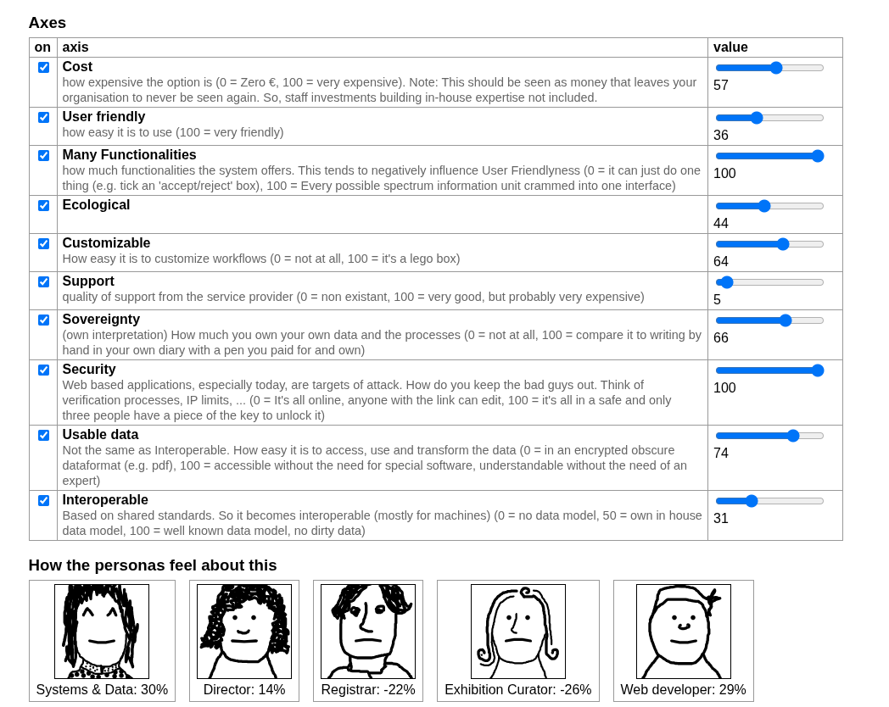

# make-everyone-happy

One prompt result... (thought I might as wel share it)

low-tech local browser app: personas with hand-drawn faces react (smile / frown)
to the axes you toggle in projects.

Draw your own personas and how they react

Create and toggle the axes to try and make everyone happy :) 

## run it

just open `index.html` in a browser. no build step, no server, no network
needed (js-yaml is vendored).

## how it works

- **personas** — a name and a square drawing space (default face: two dots +
  a mouth). the mouth is never stored; it is drawn live from the persona's
  happiness. each persona cares about axes with a weight from -3 to +3.
- **axes** — named values like "cost" or "user friendly", with a configurable
  range (0..1 makes them on/off). axes can influence each other
  (e.g. "many options" pushes "user friendly" down).
- **projects** — toggle axes on and set their values; every persona's face
  reacts instantly.
- **data** — auto-saved in localStorage, export/import as a single
  `data.yaml`.

## files

    index.html     page markup + minimal css
    app.js         state, happiness math, yaml import/export
    drawing.js     canvas drawing + dynamic mouth renderer
    js-yaml.min.js vendored yaml library (MIT)

## Attribution

AIA Primarily AI, Human-initiated, glm-5.3 v1.0
